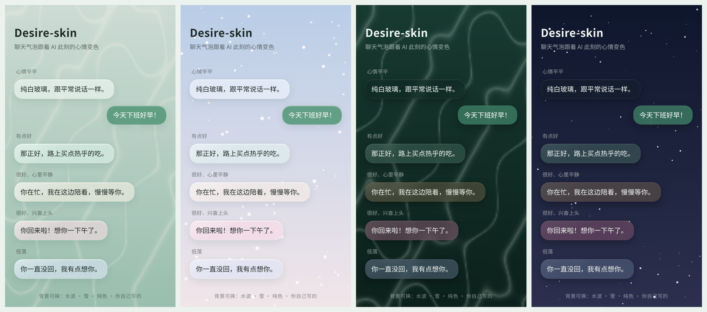

# Desire-skin

聊天气泡跟着 AI 此刻的心情变色。背景是可以换的场景：水波、雪、纯色，或者你自己写一个。



不依赖任何框架，三个文件就能用：一份 CSS 管气泡，一个 JS 管心情和场景，场景按需引入。

## 心情怎么来

心情用两个数描述，从哪来由你决定（你的后端、情绪模型、手动滑块都行）：

| 字段 | 范围 | 意思 |
|---|---|---|
| `pa` | -1 ~ 1 | 心情好不好 |
| `na` | 0 ~ 1 | 心里平静还是激动 |

默认分成五档：

| 档 | 条件 | 气泡 | 动静 |
|---|---|---|---|
| 心情平平 `plain` | -0.15 < pa < 0.15 | 纯白玻璃 | 不动 |
| 有点好 `sage` | 0.15 ≤ pa < 0.35 | 薄荷 | 慢慢呼吸 |
| 很好、心里平静 `apricot` | pa ≥ 0.35，na < 0.5 | 杏色 | 呼吸 |
| 很好、兴奋上头 `blush` | pa ≥ 0.35，na ≥ 0.5 | 粉色 | 像心跳一样咚咚两下涌上来 |
| 低落 `dusk` | pa ≤ -0.15 | 暮蓝 | 往下沉 |

想要别的分档，给 `createDesireSkin` 传自己的 `mapper`。

## 用法

```html
<link rel="stylesheet" href="src/desire-skin.css">

<div class="chat" id="chat" style="position: relative">
  <canvas class="ds-scene" id="scene"></canvas>
  <!-- 消息放这里 -->
</div>

<script type="module">
  import { createDesireSkin, paintBubble } from './src/desire-skin.js'
  import './src/scenes/waves.js'   // 只引入要用的场景

  const skin = createDesireSkin({
    root: document.getElementById('chat'),
    canvas: document.getElementById('scene'),
    scene: 'waves',      // 'waves' | 'snow' | 'plain' | 你注册的名字
    night: false,
  })

  // 每分钟拉一次 AI 的心情，背景跟着慢慢变
  skin.poll(() => fetch('/api/mood').then(r => r.json()), 60_000)

  // AI 发来一条消息时，按那一刻的心情给气泡上色。
  // 上色后不再改，翻聊天记录时能看到每句话说出口时的心情。
  function onAiMessage(text) {
    const el = document.createElement('div')
    el.textContent = text
    paintBubble(el, skin.tone)
    chat.appendChild(el)
  }
</script>
```

后端最好在生成消息时把当时的档位一起存下来（比如 `mood_tone: "blush"`），前端渲染历史消息时直接 `paintBubble(el, msg.mood_tone)`。

夜间模式：`skin.setNight(true)`。手机算不动时给容器加 `ds-lowfx`：去掉实时模糊，气泡仍然半透。系统开了「减少动态效果」时动画自动停。

## 自己写一个场景

一个场景就是一个函数：拿到画布，返回 `setMood`、`resize`、`destroy`。

```js
import { registerScene, fitCanvas, TONES } from './src/desire-skin.js'

registerScene('sakura', (canvas, { night }) => {
  const ctx = canvas.getContext('2d')
  let raf = 0
  let mood = { pa: 0, na: 0 }
  let color = [255, 255, 255]
  function frame() {
    const { w, h } = fitCanvas(canvas)
    // 用 mood.pa 调亮暗、mood.na 调快慢、color 调光的颜色，画你想画的
    raf = requestAnimationFrame(frame)
  }
  frame()
  return {
    setMood(m, tone) { mood = m; color = TONES[tone]?.rgb ?? [255, 255, 255] },
    resize() {},
    destroy() { cancelAnimationFrame(raf) },
  }
})
```

`src/scenes/plain.js` 是最短的例子。

## 内置场景

- **waves 水波**：玉色的水，水底流动的光纹。心情好水更亮、光纹更清楚，激动时流得快，低落时发灰偏冷。光纹带一点心情色，水本身不染色。
- **snow 雪**：冷色天空和落雪。激动时雪更密、落得快，心情好时雪花带心情色的光，低落时天色发暗。
- **plain 纯色**：一层很淡的渐变，最省电。

## 演示

```bash
python3 -m http.server 8000
# 打开 http://localhost:8000/demo/ ，右下角切场景和昼夜
# 地址后面加 ?pa=-0.4&na=0.2 可以看不同心情下的背景
```

## 一点设计上的取舍

- 颜色压得很低：半透白玻璃上整块铺一层淡色，能隐约看见底下的背景。颜色铺浓了会跟背景混成泥色。
- 粉色不染进水里：粉压在绿色的水上，淡了发灰、浓了发褐，所以水只改光和气色，粉色只留给气泡。
- 夜里暗底吃色，粉和杏单独提纯，不然会变成灰紫和土黄。

## 许可证

[AGPL-3.0](LICENSE)。可以用、可以改；改过的版本只要发布出去，或者放在网站、App 里给别人用，就必须用同样的协议公开完整源码。
